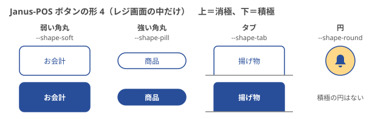

# Janus-POS デザイン言語

<!-- このファイルと design-language.svg・design-shapes.svg は pos/scripts/design-sheet.mjs が styles.css から作る。手で直さず `cd pos && npm run gen:design` -->

UI はレゴのように、少ない部品の掛け合わせで組み立てる。軸はそれぞれ独立した四つずつ。

| 軸 | 四つ |
| --- | --- |
| 文字サイズ | 特大 最大 96px（`--text-xl`）・強調 24px（`--text-num`）・大 18px（`--text-lg`）・小 12px（`--text-sm`） |
| 色 | 青 #005AFF（操作可能）・緑 #03AF7A（安全・肯定）・赤 #FF4B00（危険・否定）・橙 #F6AA00（着目・注意喚起）。白・黒・グレーは色に数えない無彩色 |
| 濃度 | 1 淡（明るさ 0.95）・2 薄（0.87）・3 中（その色そのもの。グレーは 0.52）・4 濃（0.44） |
| ボタンの形 | 弱い角丸（`--shape-soft`）・強い角丸（`--shape-pill`）・タブ（`--shape-tab`）・円（`--shape-round`） |
| ボタンの大きさ | 特大 160×64・大 116×48・中 64×34・小 56×26 |

## 適用範囲

デザイン言語（文字サイズ・色・濃度・ボタンの形・ボタンの大きさ）が及ぶのは**レジ画面の中だけ**（ヘッダー・帯・三段目・最下段、その上に開くテンキーと数量のポップアップ）。次のものは対象外で、この表の四つに縛られない。

- 周辺機器：入金ボックス・出金ボックス・決済端末・スキャナ、Bell の呼び鈴端末（据え付け端末・可搬性端末・ストアコンピューター）
- シミュレーターまわり：ページ上部のヘッダー（ロゴ・ビルド番号・ログインの選択・リセット）、Bell エリア、Item・Wallet、ダイアログ（販売規則の設定・Bell の設定・モバイルの長押しピッカー）、モバイルの画面切替、トースト・ツールチップ、著作権表示

## ボタンの形

形と大きさは独立に組み合わせる。積極（濃い背景・白文字・枠線なし）と消極（濃い枠線・濃い文字・背景なし）は形ではなく塗り方で、弱い角丸にも強い角丸（選択中＝積極）にもタブ（選ばれている＝積極）にも使う。押せないものはどの形でもグレーアウトする（状態であって形ではない）。

| 形 | 角の丸み | 意味 | レジ画面で使うところ |
| --- | --- | --- | --- |
| 弱い角丸 | `--shape-soft` 8px | 積極・消極。押すと何かが起きるボタン | 会計・はい・決定などの積極ボタン、バック・スキップ・取引中止、明細の削除・−・＋、テンキーのキー、FF 単品とページ送り、最下段（FF・サービス・金券・たばこ）、帯の Language・電子マネー、店舗メニューの項目、フラグ |
| 強い角丸 | `--shape-pill` 999px | 案内。画面遷移を伴わず案内を出すだけの第三のボタン | 待ち受けの案内ボタン、支払方法のボタン |
| タブ | `--shape-tab` 上の角 6px | 上の角だけ丸め、下は線に載せる | FF のタブ |
| 円 | `--shape-round` 50% | 文字のない記号一つのボタン（ベル・歯車） | 呼び鈴（ヘッダーは小、待ち受けの帯は大）。Bell エリアの歯車も同じ円 |

ボタンではないので四種の例外：

- セレクタ：チェックボックス（FF のお渡し照合、公共料金・印紙の確認）、プルダウン
- 入力フォーム：角を丸めない四角（数量・荷物の長さと重さ・郵便番号・生年月日・お渡し数など、押すとテンキーが開く欄）。角の丸みはボタンだけの表現

## 濃度の役割

| 濃度 | 役割 | 使ってはいけないこと |
| --- | --- | --- |
| 4 濃 | アクセントカラー。文字の色と枠線の色 | 広い面の塗りつぶし |
| 3 中 | 添え字（小テキストの補足：値段・期限・案内の二行目など） | 本文の文字、塗りつぶし |
| 2 薄 | 塗りつぶし（帯・最下段など濃いめの段、行の色） | 文字、枠線 |
| 1 淡 | 塗りつぶし（一段目・三段目など明るい段、確認画面） | 文字、枠線 |

塗りつぶしの上に載せる文字と枠線は濃度4。濃度4の文字は、どの大きさでも、白・濃度1・濃度2のどの背景でも読める。

## 見本

## 使ってはいけない組み合わせ

文字の色と、その文字が載る背景とのコントラスト比で決める。小テキスト（添え字を含む）は 4.5:1 以上、特大・強調は 3:1 以上がいる。

- 濃度1・2は文字に使わない（背景に対して 1.00〜1.56:1）。
- 添え字に使えるのは グレー3（`--grey-3`）、青3（`--blue-3`）（白・濃度1の上）。緑3（`--green-3`）、赤3（`--red-3`）、橙3（`--orange-3`） は添え字に足りないので、文字には使わない。色の意味は濃度4の文字・枠線で示し、添え字はグレー3にする。
- 濃度2の背景（帯・最下段）の上では、グレー3（`--grey-3`）も 3.52:1、青3（`--blue-3`）も 3.43:1 で添え字に足りない。帯と最下段に添え字を置くときの扱いは未決。

## 面の塗り分け（設計メモ）

隣り合う面は違う色で塗る。いまのレジ画面は段が縦に積み重なっているだけなので、隣り合うのは上下の段だけで、濃度1と2を交互に塗れば足りる（一段目・三段目＝淡、帯・最下段＝薄）。画面どうしは、操作できる側（緑）とできない側（赤）の色相で分ける。

ある領域を奇数個の領域が囲む配置ができたら、2〜3色では塗り分けられない。そのときは四色定理（平面の地図は 4 色あれば隣り合う領域を必ず塗り分けられる）を応用する。色相には意味があるので、塗り分けのためだけに色相を使わず、明るさの段で分けることを先に考える。

## コントラスト比の表

背景は、白と濃度1（グレー・緑・赤・橙の 1）のうち一番低いもの、濃度2（同じく 2）のうち一番低いもの。○ 4.5:1 以上、△ 3:1 以上（特大・強調だけ）、✕ 3:1 未満。

| 色 | 役割 | OKLCH | 白 | 白・濃度1 | 濃度2 |
| --- | --- | --- | --- | --- | --- |
| グレー1（`--grey-1`） | 塗りつぶし（文字に使わない） | `oklch(0.95 0 0)` | 1.16 | 1.00 ✕ | 1.25 ✕ |
| グレー2（`--grey-2`） | 塗りつぶし（文字に使わない） | `oklch(0.87 0 0)` | 1.48 | 1.25 ✕ | 1.00 ✕ |
| グレー3（`--grey-3`） | 添え字（小テキスト）だけ | `oklch(0.52 0 0)` | 5.51 | 4.66 ○ | 3.52 △ |
| グレー4（`--grey-4`） | アクセント（文字・枠線） | `oklch(0.44 0 0)` | 7.77 | 6.57 ○ | 4.96 ○ |
| 青1（`--blue-1`） | 塗りつぶし（文字に使わない） | `oklch(0.95 0.028 262.2)` | 1.16 | 1.00 ✕ | 1.25 ✕ |
| 青2（`--blue-2`） | 塗りつぶし（文字に使わない） | `oklch(0.87 0.072 262.2)` | 1.49 | 1.26 ✕ | 1.00 ✕ |
| 青3（`--blue-3`） | 添え字（小テキスト）だけ | `oklch(0.542 0.254 262.2)` | 5.37 | 4.54 ○ | 3.43 △ |
| 青4（`--blue-4`） | アクセント（文字・枠線） | `oklch(0.44 0.13 262.2)` | 7.92 | 6.70 ○ | 5.06 ○ |
| 緑1（`--green-1`） | 塗りつぶし（文字に使わない） | `oklch(0.95 0.022 162.8)` | 1.15 | 1.00 ✕ | 1.26 ✕ |
| 緑2（`--green-2`） | 塗りつぶし（文字に使わない） | `oklch(0.87 0.056 162.8)` | 1.45 | 1.23 ✕ | 1.00 ✕ |
| 緑3（`--green-3`） | 添え字（小テキスト）だけ | `oklch(0.667 0.144 162.8)` | 2.83 | 2.40 ✕ | 1.81 ✕ |
| 緑4（`--green-4`） | アクセント（文字・枠線） | `oklch(0.44 0.095 162.8)` | 7.39 | 6.25 ○ | 4.72 ○ |
| 赤1（`--red-1`） | 塗りつぶし（文字に使わない） | `oklch(0.95 0.034 36.6)` | 1.18 | 1.00 ✕ | 1.23 ✕ |
| 赤2（`--red-2`） | 塗りつぶし（文字に使わない） | `oklch(0.87 0.088 36.6)` | 1.56 | 1.32 ✕ | 1.00 ✕ |
| 赤3（`--red-3`） | 添え字（小テキスト）だけ | `oklch(0.666 0.225 36.6)` | 3.35 | 2.84 ✕ | 2.14 ✕ |
| 赤4（`--red-4`） | アクセント（文字・枠線） | `oklch(0.44 0.13 36.6)` | 8.26 | 6.98 ○ | 5.28 ○ |
| 橙1（`--orange-1`） | 塗りつぶし（文字に使わない） | `oklch(0.95 0.04 76.6)` | 1.16 | 1.00 ✕ | 1.25 ✕ |
| 橙2（`--orange-2`） | 塗りつぶし（文字に使わない） | `oklch(0.87 0.103 76.6)` | 1.50 | 1.27 ✕ | 1.00 ✕ |
| 橙3（`--orange-3`） | 添え字（小テキスト）だけ | `oklch(0.791 0.166 76.6)` | 1.97 | 1.67 ✕ | 1.26 ✕ |
| 橙4（`--orange-4`） | アクセント（文字・枠線） | `oklch(0.44 0.092 76.6)` | 7.89 | 6.67 ○ | 5.04 ○ |
