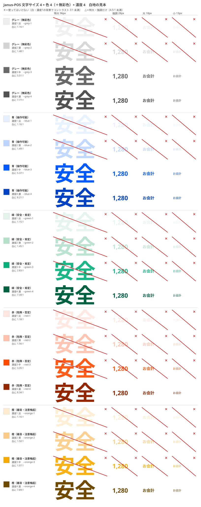

# Janus-POS デザイン言語

<!-- このファイルと design-language.svg は pos/scripts/design-sheet.mjs が styles.css から作る。手で直さず `cd pos && npm run gen:design` -->

UI はレゴのように、少ない部品の掛け合わせで組み立てる。軸はそれぞれ独立した四つずつ。

| 軸 | 四つ |
| --- | --- |
| 文字サイズ | 特大 最大 96px（`--text-xl`）・強調 28px（`--text-num`）・大 18px（`--text-lg`）・小 13px（`--text-sm`） |
| 色 | 青 #005AFF（操作可能）・緑 #03AF7A（安全・肯定）・赤 #FF4B00（危険・否定）・橙 #F6AA00（着目・注意喚起）。白・黒・グレーは色に数えない無彩色 |
| 濃度 | 1 淡（明るさ 0.95）・2 薄（0.87）・3 中（その色そのもの。グレーは 0.52）・4 濃（0.44） |
| ボタンの形 | 積極・消極・案内（強い丸み。円は案内の正方形）・タブ |
| ボタンの大きさ | 特大 160×64・大 116×48・中 64×34・小 56×26 |

## 文字サイズ × 色 × 濃度の見本

## 使ってはいけない組み合わせ

文字の色と、その文字が載る背景とのコントラスト比で決める。

- ✕：コントラスト比が 3:1 未満。大きさに関わらず、文字に使ってはいけない。
- △：3:1 以上 4.5:1 未満。特大・強調（大きな文字）にだけ使える。大・小には使ってはいけない。
- ○：4.5:1 以上。すべての大きさに使える。

白と濃度1の背景（一段目・三段目、確認画面）の上で：

- ✕ 文字に使わない：グレー1（`--grey-1`）、グレー2（`--grey-2`）、青1（`--blue-1`）、青2（`--blue-2`）、緑1（`--green-1`）、緑2（`--green-2`）、緑3（`--green-3`）、赤1（`--red-1`）、赤2（`--red-2`）、赤3（`--red-3`）、橙1（`--orange-1`）、橙2（`--orange-2`）、橙3（`--orange-3`）。淡・薄は背景の色で、文字の色ではない。
- △ 特大・強調だけ：なし。

濃度2の背景（帯・最下段）の上では、さらに次の判定が下がる。帯と最下段に置く文字は濃度4（濃）を基本にする。

- グレー3（`--grey-3`）：○ → △（濃度2の背景で 3.52:1）
- 青3（`--blue-3`）：○ → △（濃度2の背景で 3.43:1）

## コントラスト比の表

背景は、白と濃度1（グレー・緑・赤・橙の 1）のうち一番低いもの、濃度2（同じく 2）のうち一番低いもの。

| 文字の色 | OKLCH | 白 | 白・濃度1 | 濃度2 |
| --- | --- | --- | --- | --- |
| グレー1（`--grey-1`） | `oklch(0.95 0 0)` | 1.16 | 1.00 ✕ | 1.25 ✕ |
| グレー2（`--grey-2`） | `oklch(0.87 0 0)` | 1.48 | 1.25 ✕ | 1.00 ✕ |
| グレー3（`--grey-3`） | `oklch(0.52 0 0)` | 5.51 | 4.66 ○ | 3.52 △ |
| グレー4（`--grey-4`） | `oklch(0.44 0 0)` | 7.77 | 6.57 ○ | 4.96 ○ |
| 青1（`--blue-1`） | `oklch(0.95 0.028 262.2)` | 1.16 | 1.00 ✕ | 1.25 ✕ |
| 青2（`--blue-2`） | `oklch(0.87 0.072 262.2)` | 1.49 | 1.26 ✕ | 1.00 ✕ |
| 青3（`--blue-3`） | `oklch(0.542 0.254 262.2)` | 5.37 | 4.54 ○ | 3.43 △ |
| 青4（`--blue-4`） | `oklch(0.44 0.206 262.2)` | 8.21 | 6.95 ○ | 5.25 ○ |
| 緑1（`--green-1`） | `oklch(0.95 0.022 162.8)` | 1.15 | 1.00 ✕ | 1.26 ✕ |
| 緑2（`--green-2`） | `oklch(0.87 0.056 162.8)` | 1.45 | 1.23 ✕ | 1.00 ✕ |
| 緑3（`--green-3`） | `oklch(0.667 0.144 162.8)` | 2.83 | 2.40 ✕ | 1.81 ✕ |
| 緑4（`--green-4`） | `oklch(0.44 0.095 162.8)` | 7.39 | 6.25 ○ | 4.72 ○ |
| 赤1（`--red-1`） | `oklch(0.95 0.034 36.6)` | 1.18 | 1.00 ✕ | 1.23 ✕ |
| 赤2（`--red-2`） | `oklch(0.87 0.088 36.6)` | 1.56 | 1.32 ✕ | 1.00 ✕ |
| 赤3（`--red-3`） | `oklch(0.666 0.225 36.6)` | 3.35 | 2.84 ✕ | 2.14 ✕ |
| 赤4（`--red-4`） | `oklch(0.44 0.149 36.6)` | 8.34 | 7.06 ○ | 5.33 ○ |
| 橙1（`--orange-1`） | `oklch(0.95 0.04 76.6)` | 1.16 | 1.00 ✕ | 1.25 ✕ |
| 橙2（`--orange-2`） | `oklch(0.87 0.103 76.6)` | 1.50 | 1.27 ✕ | 1.00 ✕ |
| 橙3（`--orange-3`） | `oklch(0.791 0.166 76.6)` | 1.97 | 1.67 ✕ | 1.26 ✕ |
| 橙4（`--orange-4`） | `oklch(0.44 0.092 76.6)` | 7.89 | 6.67 ○ | 5.04 ○ |
